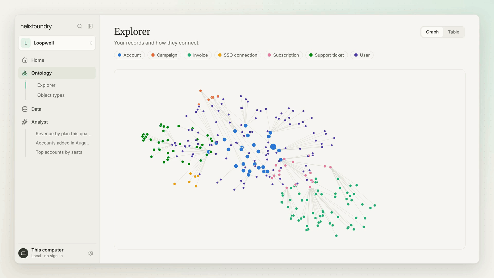

> **[中文化] helix-foundry**
>
> 此项目是 [HelixDB/helix-foundry](https://github.com/HelixDB/helix-foundry) 的中文翻译版本。
> - 原项目 Stars: 1029
> - 主语言: TypeScript
> - 许可证: Apache-2.0
> - 翻译日期: 2026-10-11
> - 原始 README: [README_en.md](README_en.md)
>
> 说明：下方 README 正文为**原项目文档的中文翻译**，力求忠于原文；本页顶部的「中文快速上手」为**面向中文用户的补充导读**（非原文内容），目的是让你不用读完整篇 README 就能先把项目跑起来。
>
> 如有翻译不准确之处，欢迎提 Issue 或 PR。

---


## 🚀 中文快速上手（补充导读，非原文）

### 这是什么 / 解决什么问题

Helix Foundry 是一个本地优先（local-first）的数据工作台，构建在 HelixDB 和 DuckDB 之上。它把公司已经在用的工具（数据库、Stripe、WorkOS、PostHog、文件和 API 等）连接起来，自动建议一个跨数据源的统一本体（ontology），供你浏览和提问。它不需要账号、不需要托管，运行在你自己的电脑上，AI 默认在本地运行。

### 快速上手（最短路径）

1. 确认已安装并运行 Docker（首次运行会下载数 GB 数据，需要几分钟）。
2. 把下面这段提示词粘贴到 Claude Code、Codex、Cursor 或任何能执行终端命令的编码 agent 中：

   ```text
   Set up Helix Foundry on this computer.

   Clone https://github.com/helixdb/helix-foundry.git (or use the copy I already
   have), cd into it, then read AGENTS.md and follow it to install, start and
   verify the app. Ask me before doing anything that deletes data or stops
   something that is already running. When it is ready, give me the URL and
   tell me what to do next.
   ```

3. 按提示逐个批准 `git`、`docker` 和网络命令（不要一次性全部放行）。
4. 打开 agent 给出的 URL（默认 http://localhost:3001），无需创建账号。
5. 按引导完成 **AI → Data → Ontology** 设置：选择 Local、Claude 或 OpenAI，连接数据或选择 **Continue with sample data**，然后确认建议的本体。

**手动方式（不使用 agent）：**

```sh
git clone https://github.com/helixdb/helix-foundry.git
cd helix-foundry
./scripts/setup.sh --compose
```

就绪后健康检查返回：

```sh
curl -fsS http://localhost:3001/api/health
# {"ok":true,"service":"helix-foundry"}
```

然后打开 **http://localhost:3001**。

### 环境要求

- **操作系统：** 在 macOS（Apple Silicon）上开发和验证，CI 运行在 Linux。Windows 未测试，脚本需要 bash。
- **Docker：** 需要 Docker 及 Compose v2 插件（`docker compose`，不是 `docker-compose`），已用 Compose 2.29 检查。
- **其他工具：** git、bash、openssl（用于安装脚本）。
- **磁盘：** 首次运行需要数 GB（应用镜像约 0.9 GB，加上 HelixDB、Ollama 和 `qwen3:4b` 模型）；之后还需为你的数据留出空间，导入大文件时运行期间可能占用其体积的数倍。
- **内存：** 本地 AI 在 16 GB 机器上开发和基准测试；需给 Docker 足够内存运行模型，否则在设置时选择 Claude 或 OpenAI。
- **Node.js 24 和 pnpm 10.7：** 仅本地开发需要。
- **国内网络提示：** 原文未提及镜像源或加速下载方案，首次运行需下载数 GB 数据，网络条件可能影响下载速度。

### 常见坑与注意事项

- **首次运行下载量大：** 会下载应用镜像、HelixDB、Ollama 和 `qwen3:4b` 模型（约 2.5 GB），需要数分钟；模型会在后台继续下载，你可以在它完成前就开始设置。
- **端口 3001 被占用：** 需先创建 `.env`，然后同时修改端口和对应的 origin（`PUBLIC_PORT` 与 `PUBLIC_ORIGIN`），两者必须一起改；只改端口会导致页面能加载但每次保存都报 `403 Origin is not allowed`。
- **Apple Silicon 上的本地 AI：** Docker 无法使用 Metal，本地 AI 用原生 Ollama 更快；需先启动 Ollama，再按 README 中的命令以不带内置模型的方式运行（依赖 Docker Desktop 提供的 `host.docker.internal`）。
- **API Key 与凭据：** 若选择 Claude 或 OpenAI，需要你自己在浏览器中输入密钥和数据库凭据，agent 不需要这些。

---


---

<h1 align="center">
  <picture>
    <source media="(prefers-color-scheme: dark)" srcset="docs/assets/logo-dark.svg">
    
  </picture>
</h1>

<p align="center">
  <strong>你公司的数据，连接成一个本体，运行在你自己的电脑上。</strong>
</p>

Helix Foundry 是一个本地优先的数据工作空间，构建于 [HelixDB](https://docs.helix-db.com) 和 [DuckDB](https://duckdb.org) 之上。连接你公司已经在使用的工具，例如你的数据库、Stripe、WorkOS、PostHog、文件和 API，它会为你建议一个跨这些工具的互联本体，供你探索和提问。无需账户，也无需托管任何东西：它运行在你的电脑上，AI 默认在本地运行。

<p align="center">
  
</p>

## 使用你的编码代理快速开始

你需要安装并运行 [Docker](https://docs.docker.com/get-started/get-docker/)。首次运行会下载数 GB 的数据，所以请给它几分钟时间。

将以下提示粘贴到 Claude Code、Codex、Cursor 或任何能运行终端命令的编码代理中：

```text
在这台电脑上设置 Helix Foundry。

克隆 https://github.com/helixdb/helix-foundry.git（或使用我已有的副本），
cd 进入该目录，然后阅读 AGENTS.md 并按照它来安装、启动和验证应用。
在执行任何删除数据或停止已在运行的服务之前，先询问我。
准备好后，给我 URL 并告诉我下一步该做什么。
```

你的代理会在过程中请求你批准 `git`、`docker` 和网络命令。请逐一批准，而不是一开始就允许所有 `docker` 命令；运行手册会在执行任何删除数据的操作前询问。

**你的代理会做什么**

- 检查 Docker 是否正在运行，以及应用的端口（默认 3001）是否空闲，如果不空闲则选择另一个端口。
- 使用 `scripts/setup.sh` 在 `.env` 中生成本地加密密钥。
- 使用 Docker Compose 构建并启动整个技术栈，包括一个本地 AI 模型。在已运行 Ollama 的 Mac 上，它会改用那个。
- 等待健康检查通过，然后给你 URL。

**你接下来做什么**

1. 打开 URL（默认 http://localhost:3001）。无需创建账户。
2. 引导式设置会带你依次完成 **AI → 数据 → 本体**。选择 Local、Claude 或 OpenAI。连接你的数据，或选择 **使用示例数据继续**。然后确认建议的本体。
3. 主页会打开并显示你的关键指标。从顶部的输入框询问任何关于你数据的问题。

你在浏览器中自行输入 Claude 或 OpenAI 密钥以及数据库凭据。你的代理永远不需要它们。

## 手动快速开始

你需要带有 Compose v2 的 Docker（参见[要求](#requirements)）。

```sh
git clone https://github.com/helixdb/helix-foundry.git
cd helix-foundry
./scripts/setup.sh --compose
```

如果 `.env` 尚不存在，`setup.sh` 会向其中写入新的密钥，然后构建并启动应用、后台 worker、DuckDB 执行器、HelixDB 和 Ollama。首次运行会构建镜像并下载 HelixDB、Ollama 和 `qwen3:4b` 模型（大约 2.5 GB），所以请给它几分钟时间。

当健康检查响应时，它就准备好了：

```sh
curl -fsS http://localhost:3001/api/health
# {"ok":true,"service":"helix-foundry"}
```

然后打开 **http://localhost:3001**。模型会在后台继续下载，你可以在它完成之前就开始设置。

**端口 3001 已被占用？** 先创建 `.env`，然后同时设置端口和匹配的 origin：

```sh
./scripts/setup.sh                                   # 创建带有新密钥的 .env
echo 'PUBLIC_PORT=3005' >> .env
echo 'PUBLIC_ORIGIN=http://localhost:3005' >> .env
./scripts/setup.sh --compose
```

这两行只需添加一次；如果 `.env` 中已有它们，则改为修改它们的值。务必同时修改两者。如果只改了端口，页面会加载，但每次保存都会失败并报 `403 Origin is not allowed`。

**Apple Silicon。** Docker 无法使用 Metal，因此使用原生 [Ollama](https://ollama.com) 时本地 AI 会更快。启动 Ollama，然后在不使用捆绑模型的情况下运行技术栈：

```sh
./scripts/setup.sh
grep -q '^MODEL_ENDPOINT=' .env || echo 'MODEL_ENDPOINT=http://host.docker.internal:11434' >> .env
docker compose up -d --build
```

这依赖于 Docker Desktop，它提供 `host.docker.internal`。使用其他 Docker 运行时，请使用上面的默认命令。

## 要求

- **Docker** 及 Compose v2 插件（`docker compose`，而非 `docker-compose`）。已使用 Compose 2.29 验证。
- **git、bash 和 openssl**，用于设置脚本。
- **磁盘：** 首次运行需要数 GB：应用镜像（约 0.9 GB）、HelixDB、Ollama 和 `qwen3:4b` 模型。然后还需要存放你数据的空间：导入大文件时，运行期间可能需要其大小数倍的空间。参见[部署限制](docs/OPERATIONS.md#deployment-limits)。
- **内存：** 本地 AI 是在 16 GB 机器上开发和基准测试的。给 Docker 足够的内存来运行模型，或在设置期间选择 Claude 或 OpenAI。
- **Node.js 24 和 pnpm 10.7**，仅用于[本地开发](#local-development)。

Helix Foundry 在 macOS 上使用 Apple Silicon 开发和验证，CI 在 Linux 上运行。Windows 未经测试，且脚本需要 bash。

## 你将获得

- **连接器**，支持 Neon、Supabase、PlanetScale、PostgreSQL、MySQL、Stripe、WorkOS、PostHog、REST API、兼容 S3 的存储、文件上传（CSV、JSON、JSONL、Parquet）以及一个摄取 API。
- **自动同步**，在数据库允许的情况下通过原生 PostgreSQL 和 MySQL 变更捕获实现，否则通过定时快照刷新实现。
- **一个建议的本体**，跨来源匹配相同的客户和记录，并以真实对象和关系的形式存储在 HelixDB 中。
- **版本化数据：** 不可变的 Parquet 快照，带有数据剖析、Schema 漂移审查和历史记录，由隔离的 DuckDB 进程查询。
- **主页和分析师：** 关键指标，以及由已执行的 SQL 和快照引用支持的对你问题的回答。
- **你选择的 AI：** 默认通过 Ollama 使用本地 `qwen3:4b`，或使用 Claude 或 OpenAI。AI 提议的更改会经过测试并等待你的审查。
- **开发者访问：** `/api/docs` 上的 OpenAPI、一个 TypeScript SDK、限定范围的 API 令牌，以及备份、恢复和升级脚本。

完整的功能列表、连接器详情和架构见[指南](docs/GUIDE.md)。

## 日常命令

从仓库中运行这些命令。如果你使用原生 Ollama，请省略 `--profile local`。

```sh
docker compose --profile local ps -a                # 状态
docker compose --profile local logs -f app worker   # 跟踪日志（Ctrl+C 停止）
docker compose --profile local stop                 # 停止
docker compose --profile local up -d                # 再次启动
```

除非你停止了它，否则技术栈会随 Docker 一起再次启动。

**升级。** 运行 `./scripts/upgrade.sh`。它会先备份到 `~/helix-foundry-backups/`，如果备份失败则停止，然后拉取并重新构建；如果重新构建失败，请再次运行它。如果新版本更改了 HelixDB，它会先询问：更新的 HelixDB 会单向升级你的数据，所以只有那个备份能让你回退。要回退，请运行它在最后打印的两条命令。在 `scripts/upgrade.sh` 之前的检出会记录正在运行的提交并先拉取一次；参见[运维](docs/OPERATIONS.md#backup-restore-and-upgrades)。

**备份和恢复。** `./scripts/backup.sh PATH` 会短暂停止服务，并将 HelixDB 和数据卷归档到仓库外的一个文件夹。备份不包含你的加密密钥，所以请单独保存一份 `.env` 副本，例如放在密码管理器中。`--include-key` 会添加 `.env`，并使用密码短语加密。`./scripts/restore.sh PATH --replace` 会替换当前数据。除非你通过 `--env-file` 传入你的副本，否则它会拒绝使用其他密钥制作的备份，并将它替换的 `.env` 保留为 `.env.pre-restore-TIME`。

除非你确实想删除所有内容，否则永远不要运行 `docker compose down -v`。它会移除所有工作空间、导入的数据和存储的凭据。有关升级、变更捕获和限制，参见[运维](docs/OPERATIONS.md)。

## 本地开发

使用 Node.js 24 和 pnpm 10.7。在 Docker 中运行 HelixDB，并原生运行应用：

```sh
pnpm install
./scripts/setup.sh
docker run -d --name helix-foundry-dev -p 127.0.0.1:6996:8080 \
  -e HELIX_DATA_DIR=/var/lib/helix -v helix-foundry-dev:/var/lib/helix \
  ghcr.io/helixdb/helixdb:v0.0.6@sha256:94b29942658ebdca0a91bf15edffe921a46da3e26e1223ea333ccce58c6212dd
pnpm dev
```

打开 **http://localhost:5173**。`pnpm dev` 会在 3001 上运行 API，在 3002 上运行执行器，在 5173 上运行 Web 应用。本地 AI 还需要在端口 11434 上运行 Ollama（`ollama serve`）。在打开 Pull Request 之前，请运行与 CI 相同的检查：`pnpm typecheck`、`pnpm test` 和 `pnpm build`。[指南](docs/GUIDE.md#local-development)涵盖了测试、端口和 SDK。

## 安全模型

Helix Foundry 是为一个人在自己的电脑上使用而构建的。没有账户，也没有登录，因此任何能访问该应用的人都能控制每一个工作空间。

- 应用仅发布在 `127.0.0.1` 上。永远不要通过反向代理、隧道或端口转发暴露它，也永远不要发布内部的 HelixDB、执行器或 Ollama 端口。
- API 会拒绝 `Host` 不是本机的请求，以及来自任何其他 origin 的浏览器更改，并返回 `403`。
- 连接器和 AI 凭据使用 `.env` 中的 `ENCRYPTION_KEY` 加密。请将 `.env`、`.env.pre-restore-*` 文件和备份保持私密并排除在 git 之外，并将 `.env` 的副本与你的备份分开保存，因为备份不包含密钥。由旧版 `backup.sh` 制作的备份则包含：它们的 `config.env` 以明文保存两个密钥，通常位于仓库的 `backups/` 文件夹中。一旦你有了新备份和单独的 `.env` 副本，请删除那些备份，或至少删除它们的 `config.env`；只要 `backups/` 或 `~/helix-foundry-backups/` 中还有任何残留，`backup.sh` 和 `upgrade.sh` 就会发出警告。如果你丢失了密钥，存储的凭据将无法恢复。不要试图通过替换其值来轮换它。
- 生成的 SQL 在一个独立的 DuckDB 执行器中运行，该执行器位于没有互联网访问、没有连接器凭据、没有 Linux capabilities，并带有内存和进程限制的内部网络上。
- 脚本和 SDK 使用来自 **设置 → 开发者工具** 的工作空间范围 API 令牌。除非你授予写访问权限，否则令牌是只读的。

## 文档

| 文档                                     | 涵盖内容                                                                                                                                                                  |
| ---------------------------------------- | ------------------------------------------------------------------------------------------------------------------------------------------------------------------------- |
| [AGENTS.md](AGENTS.md)                   | 面向编码代理的运行手册：预检、设置、验证和故障排除                                                                                                                        |
| [docs/GUIDE.md](docs/GUIDE.md)           | 功能、连接器、AI 和审查、架构、开发和测试                                                                                                                                 |
| [docs/DESIGN.md](docs/DESIGN.md)         | 现有视觉标准、UI 令牌、进度反馈和无障碍                                                                                                                                   |
| [docs/onboarding.md](docs/onboarding.md) | 引导 API 路由、SDK 方法和导入限制                                                                                                                                         |
| [docs/OPERATIONS.md](docs/OPERATIONS.md) | 安装配置、诊断、变更捕获、备份、恢复、升级、限制